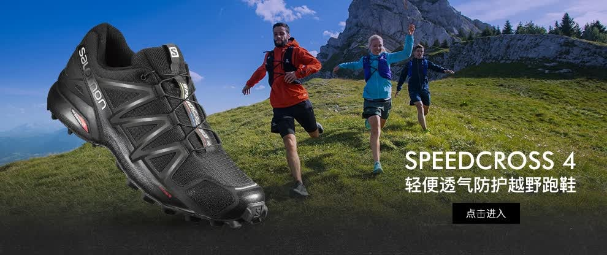
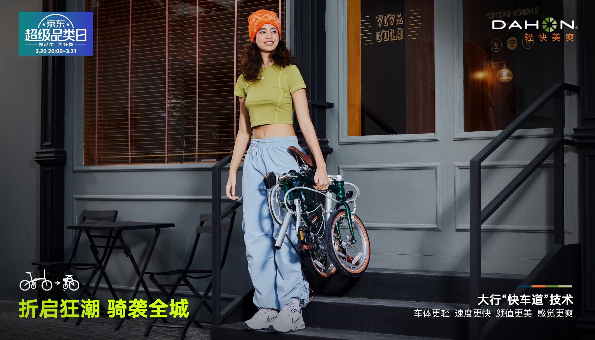
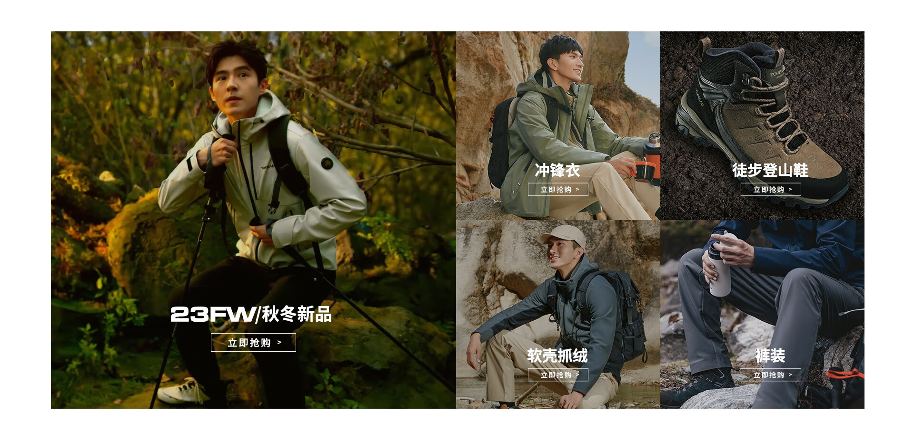

# 3_详情页头图与横幅 · 运动户外 代表图

本组按商品呈现、信息组织和动线选取不同结构。占比为目测描述，不是排版指令。

## 3-074：越野跑鞋

用途：单品展示；参考角色：使用关系参考；标签：局部特写;场景叙事;人物互动;非对称构图

可借鉴：前景完整鞋与后景真实运动场景配合，右下短文字不遮鞋底

不适合照搬：场景不能证明防护性能，鞋底纹路和鞋楦必须保真

## 3-075：折叠自行车

用途：品牌形象；参考角色：使用关系参考；标签：人物互动;场景叙事;结构展示

可借鉴：用实际折叠状态和携带动作解释收纳便利，文字分散于底部两空区

不适合照搬：车的折叠结构、重量和人物承重动作须来自真实商品

## 3-077：户外服饰与鞋靴

用途：店铺综合图；参考角色：整图布局参考；标签：卡片矩阵;完整与细节并置;人物展示

可借鉴：左侧大卡建立整体穿着印象，右侧小卡按品类及细节补充

不适合照搬：不同款式不能混成一件衣服的功能，卡片内容不可机械拼贴
