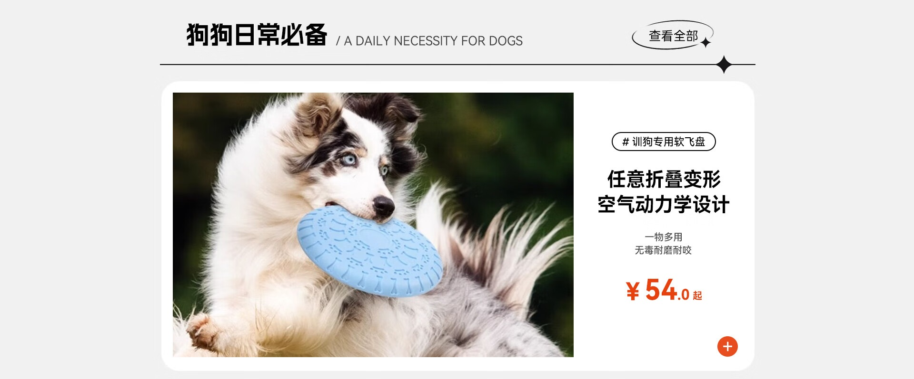
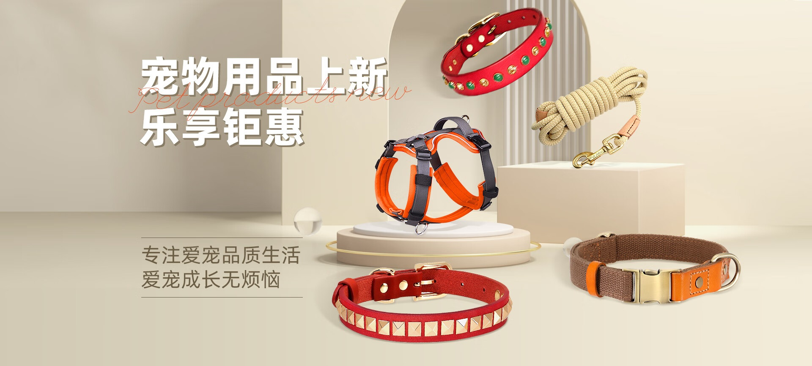
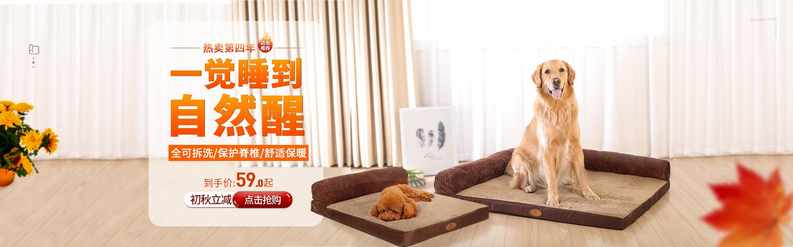

# 3_详情页头图与横幅 · 宠物用品 代表图

本组按商品呈现、信息组织和动线选取不同结构。占比为目测描述，不是排版指令。

## 3-016：犬用飞盘玩具

用途：单品展示；参考角色：使用关系参考；标签：人物互动;左右分栏;框中框

可借鉴：左侧真实使用照片直接解释用途，右侧窄栏只放最必要购买信息

不适合照搬：不要继承材质、耐咬结论或价格，犬与玩具比例应真实

## 3-019：宠物项圈牵引装备

用途：单品展示；参考角色：整图布局参考；标签：多商品组合;舞台陈列;非对称构图

可借鉴：完整胸背作为中心锚点，项圈沿周边分散形成层次

不适合照搬：没有使用场景不能据此证明舒适度，各件是否包含须核实

## 3-020：犬用睡垫

用途：单品展示；参考角色：使用关系参考；标签：人物互动;场景叙事;左右分栏

可借鉴：真实犬和睡垫接触展示承托关系，左侧窗前空区承接主题

不适合照搬：犬体型、垫子大小与价格均需替换为实际资料
