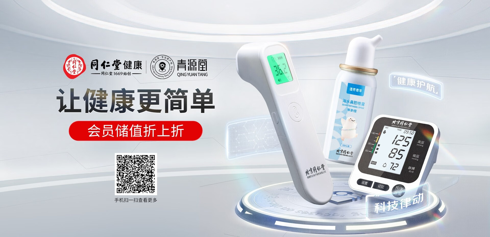
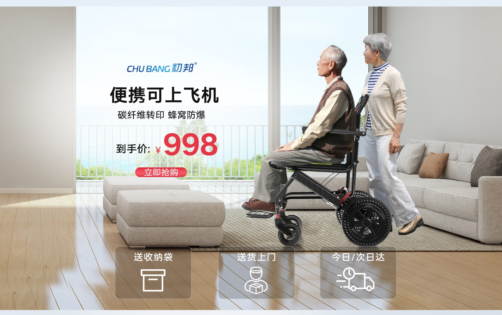
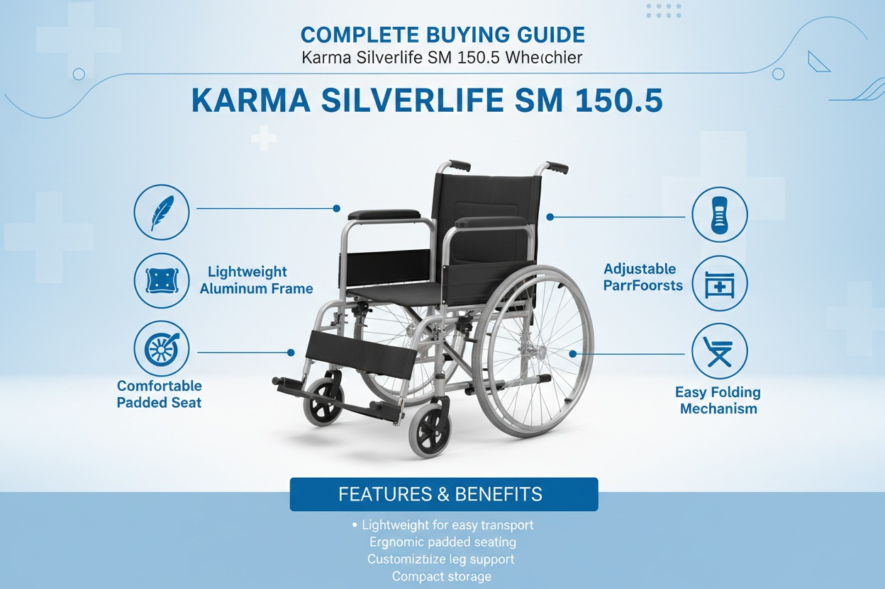

# 3_详情页头图与横幅 · 医疗健康 代表图

本组按商品呈现、信息组织和动线选取不同结构。占比为目测描述，不是排版指令。

## 3-002：药品与营养健康用品

用途：活动促销；参考角色：整图布局参考；标签：卡片矩阵;多商品组合

可借鉴：用双卡区分不同购买对象，价格与说明各自对应不串线

不适合照搬：药品和营养品不能共用功效描述，案例价格与成分不可继承

## 3-004：小型监测器械

用途：店铺综合图；参考角色：整图布局参考；标签：左右分栏;多商品组合;舞台陈列

可借鉴：右侧不同器械错开高度露出测量面板，左侧主题到入口纵向排

不适合照搬：读数、准确度、认证和二维码不能沿用

## 3-006：营养品

用途：品牌形象；参考角色：整图布局参考；标签：人物互动;非对称构图;局部特写

可借鉴：人物朝向和手势把目光带到右侧商品，短主题紧邻产品而不遮标签

不适合照搬：不能继承代言身份或暗示使用效果，瓶装规格必须真实

## 3-补构图020：大件行动辅助用品／轮椅居家使用

用途：单品展示；参考角色：使用关系参考；标签：场景叙事;人物互动;左右分栏

可借鉴：真实居家空间中展示乘坐与陪伴，左侧窗前空区承担购买信息

不适合照搬：人物姿势与车轮落地须复核，便携和航空适用不能仅凭标题继承

## 3-补构图028：大件行动辅助用品／轮椅结构指引

用途：单品展示；参考角色：局部机制参考；标签：结构展示;中心英雄;信息环绕

可借鉴：完整车架当识别锚点，左右图标通过短线对应具体部件，底部汇总少数特性

不适合照搬：此为外部厂商结构参考，不代表国内平台原广告；所有参数和结构必须按实物改写
