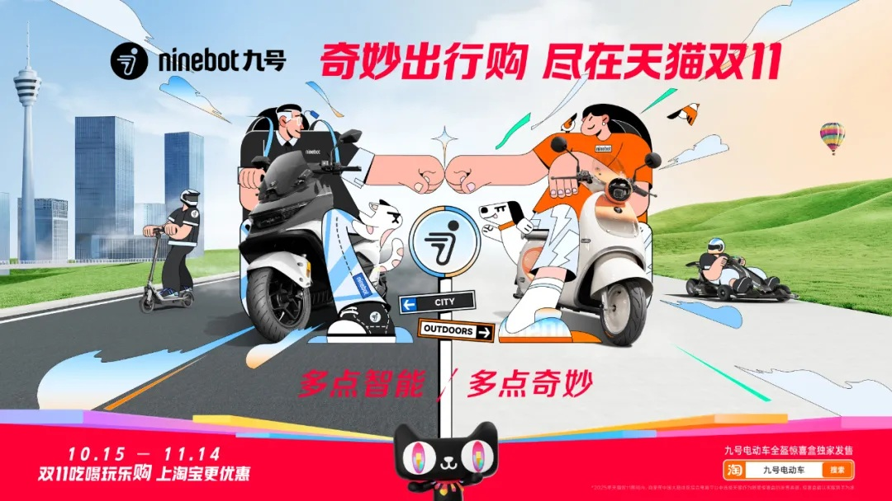
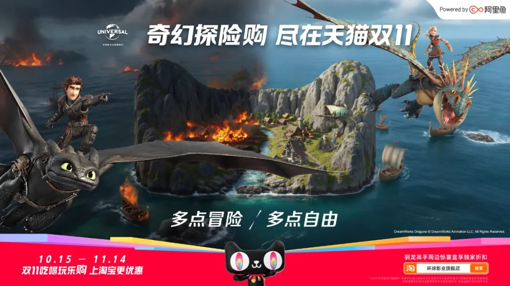
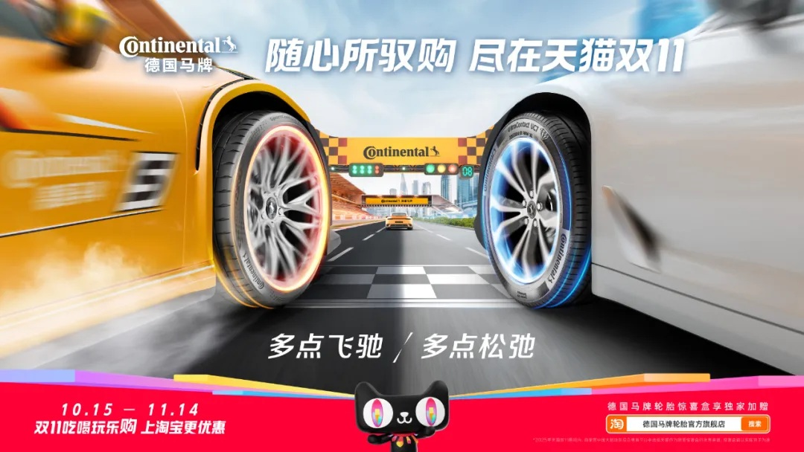

# 3_详情页头图与横幅 · 汽车用品与图书文创 代表图

本组按商品呈现、信息组织和动线选取不同结构。占比为目测描述，不是排版指令。

## 3-061：电动两轮出行用品

用途：活动促销；参考角色：整图布局参考；标签：场景叙事;IP互动;多商品组合

可借鉴：道路形成由近到远的线索，中间两辆完整车对应两种出行角色

不适合照搬：插画不能证明速度与续航，车辆结构和授权不得继承

## 3-062：图书文创与文化IP

用途：品牌形象；参考角色：整图布局参考；标签：场景叙事;IP互动;非对称构图

可借鉴：用大范围冒险场景提供情绪主题，少量上下文字保持叙事连贯

不适合照搬：这是IP形象案例，不是实体图书展示，不能沿用人物与授权

## 3-063：汽车轮胎

用途：品牌形象；参考角色：整图布局参考；标签：局部特写;场景叙事;对称透视

可借鉴：两侧轮胎放大建立隧道式视线，中间道路把目光引向远方

不适合照搬：裁切无法说明完整花纹和型号，安全性能不能从速度氛围推断

## 3-补构图089：实体图书集合

用途：活动促销；参考角色：整图布局参考；标签：中心英雄;多商品组合;舞台陈列;字体主导

可借鉴：台上完整书本建立品类识别，主题上置、配送规则下置，三层信息不混合

不适合照搬：书名封面、配送规则、优惠条件不可继承
